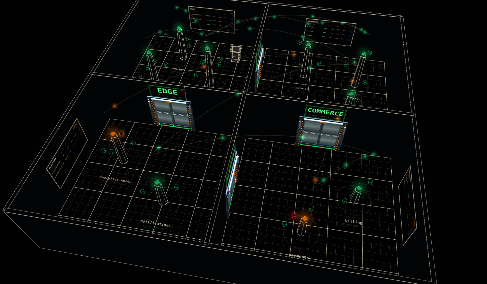
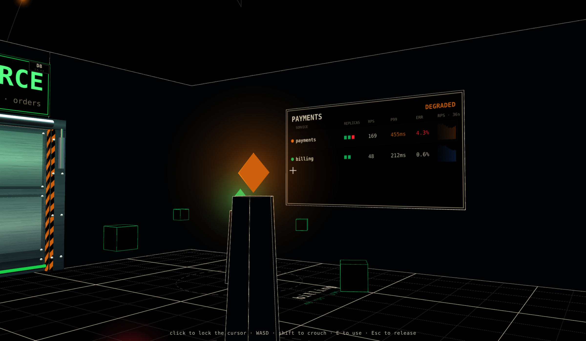
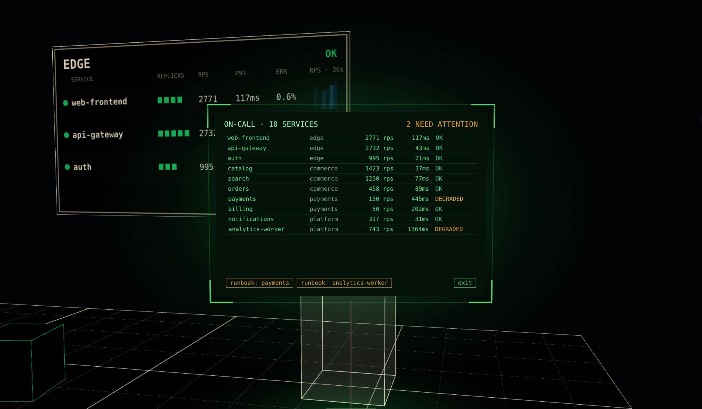

# site-world

A walkable 3D operations room for [React Three Fiber](https://r3f.docs.pmnd.rs).
Draw your data as a *place*: rooms with boards on the walls, sliding doors, terminals you walk up to
and press **E** at, an orbit camera for looking around and a first-person walk mode for being in it.
It started as the live "SITE" view of an engineering dashboard and was lifted out as a library.



| Walk in: the PAYMENTS room mid-incident | The on-call console, powered |
| --- | --- |
|  |  |

<sub>All from `examples/company`, a fictional company running ten microservices. Regenerate with `bun run screenshot`.</sub>

## Why

Are your agents spinning up more services than anyone can keep track of? Is your orchestration and
infrastructure getting out of control?

Teams and their agents now ship services, queues, workers and pipelines faster than anyone can draw
them. The diagram in the wiki was out of date the week it was made, and a new developer's mental model
of "what runs where" is a list of names in a dashboard. Lists don't stick. *Places* do.

site-world turns your internal systems into a building you can walk around in:

- **One room per system.** A team, a cluster or a pipeline gets its own room; services stand in it as
  machines with live screens. How big a room is, and how crowded, *shows* you how much is in it.
- **Doors are boundaries.** What connects to what, and what is walled off, becomes the floor plan rather
  than a line in a config file.
- **Walk up and look.** Press **E** at a terminal for its live status, logs or controls. Its screen is
  real DOM from your own app, so it can show anything your dashboard already can.
- **An orbit view for the big picture**, and a first-person walk for the close-up. A new developer
  learns the layout the way they'd learn a new office.

The library is the engine: the viewport, rooms, doors, terminals and walk physics. Your app supplies
the world as plain data (the layout, the rooms, what each terminal shows), so it can be generated from
whatever already describes your infrastructure.

```tsx
import { SiteWorld, GridFloor, WallBoxes } from "site-world";

<SiteWorld
  mode="orbit"            // or "walk"
  reduce={false}
  camera={CAMERA}         // {home, target, walkStart, walkLookAt}
  rooms={[notesRoom]}     // modules that own a terminal, a board, a feed
  doors={DOORS}           // plain data: where, how wide, how it opens
  solids={wallsAndFloorAsBoxes}
  cameraRef={cameraRef}
  onOpenPage={(to) => navigate(to)}
>
  <GridFloor {...bounds} />
  <WallBoxes walls={WALLS} />
</SiteWorld>
```

## Try it

```bash
bun install
bun run example:company   # ten microservices in four rooms, live (the screenshots above)
bun run example           # the smallest world: one room, a door, a terminal, a pylon, and demons
```

Both use only the public API.

- [`examples/company/`](examples/company/) is a fictional company's ten microservices as a building:
  a room per domain, a pylon per service (its height is traffic, its orbiting cubes are replicas, its
  beacon is health), a live dashboard per room, the call graph overhead, and an on-call console.
  [`services.ts`](examples/company/src/services.ts) is the one file to replace with your own service
  catalogue and metrics; [`serviceRoom.tsx`](examples/company/src/serviceRoom.tsx) turns a domain into a room.
- [`examples/basic/`](examples/basic/) is the starter: start by reading
  [`notesRoom.tsx`](examples/basic/src/notesRoom.tsx) to see what a room is.

## What you get

| Piece | What it is |
| --- | --- |
| `<SiteWorld>` | The viewport: canvas, orbit/walk cameras, doors, rooms, terminals, the DOM layer for screens. |
| **Rooms** (`defineRoom`) | One module = one room: `useModel` (data), `Scene` (3D), `Overlay` (DOM screen), `Colliders`, `prompt`. |
| **Terminals** | A screen on a plinth. One slot powers at most one at a time; walking up never powers it, **E** (or a click in orbit) does. |
| **Doors** | `SiteDoor` data → leaf, frame, walk-up trigger, collider box. Slide or bi-parting. |
| **Walk mode** | Capsule physics on an octree: crouch, jump, coyote time, ramps, a kill plane with checkpoints. |
| **Doom** | A small, optional demon shooter that runs in your world's floor plan. |

## Install

```bash
bun add github:makektm/site-world
```

Peer dependencies: `react`, `react-dom`, `three`, `@react-three/fiber`, `@react-three/drei`, `maath`
(see `package.json` for ranges).

The package ships **TypeScript source** (no build step), so let your bundler compile it:

- Vite: `optimizeDeps: { exclude: ["site-world"] }` (and, for Vitest, `test.server.deps.inline: ["site-world"]`).
- Next.js: `transpilePackages: ["site-world"]`.

The package ships its `tsconfig.json` (automatic JSX runtime) so esbuild/Vite compile its TSX correctly.

## Learn the codebase

Start with [`AGENTS.md`](AGENTS.md) (humans: it is also the contributor map), then:

- [`docs/ARCHITECTURE.md`](docs/ARCHITECTURE.md) — how the pieces fit and why it is two React trees.
- [`docs/GUIDE-first-world.md`](docs/GUIDE-first-world.md) — build a world from nothing.
- [`docs/GUIDE-add-a-room.md`](docs/GUIDE-add-a-room.md) — add a terminal / board room.
- [`docs/GUIDE-add-a-door.md`](docs/GUIDE-add-a-door.md) — add a door.
- [`docs/GUIDE-doom.md`](docs/GUIDE-doom.md) — wire up (or leave out) the game.
- [`docs/REFERENCE.md`](docs/REFERENCE.md) — every export, one line each (generated; CI keeps it current).

## Develop

```bash
bun run check          # typecheck + tests
bun run example        # hot-reloading example against ./src
```

MIT licensed. See [`LICENSE`](LICENSE). Contributions: [`CONTRIBUTING.md`](CONTRIBUTING.md).
