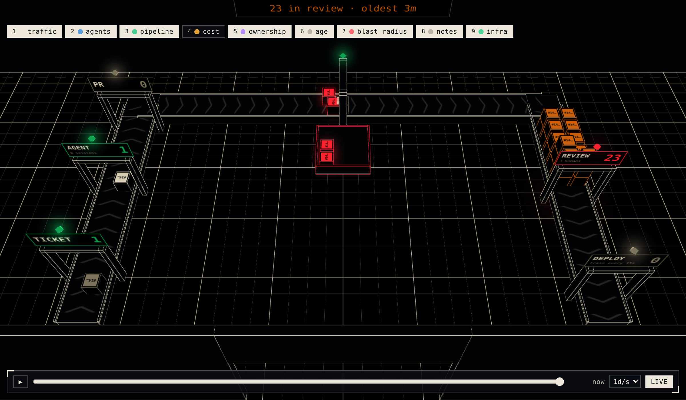
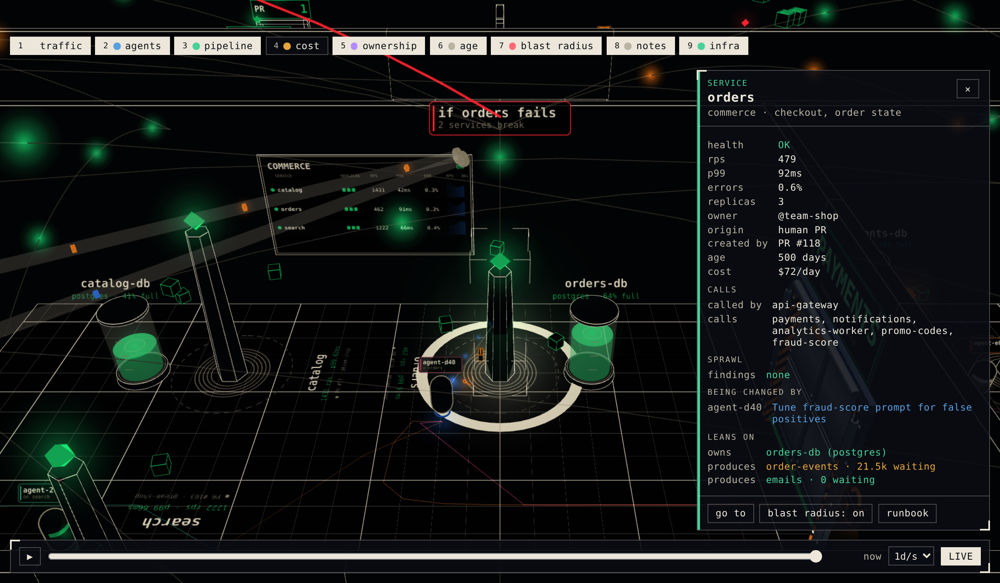

# Site World: your infrastructure, as a building you can walk through

`site-world` is a walkable 3D operations room for [React Three Fiber](https://r3f.docs.pmnd.rs).
Draw your data as a *place*: rooms with boards on the walls, sliding doors, terminals you walk up to
and press **E** at, an orbit camera for looking around and a first-person walk mode for being in it.
It started as the live "SITE" view of an engineering dashboard and was lifted out as a library.


## What you can see

- **Agents at work.** Each AI coding session is a small drone that walks to the service it is changing.
  Its visor shows what it is doing; a "?" means it is stuck waiting on someone.
- **The factory floor.** Work moves along a conveyor: ticket, agent, PR, CI, review, deploy. Failed CI
  drops into a reject bin. PRs waiting for a human pile up at review, so a slow review is easy to spot.
- **Sprawl.** Services nothing calls, look-alike duplicates, services with no team owner, who made each
  one (a person or an agent) and how old it is.
- **What services lean on.** Databases as tanks, queues as pipes with their backlog, third parties at
  the loading dock, cost per room, and padlocks on secrets.
- **Blast radius.** Select a service and see what breaks if it fails.

## What you can do

- **Inspect** anything: click it (or press **E** in walk mode) for a panel with its details.
- **Layers**: turn traffic, agents, cost, ownership, age, blast radius and more on and off (keys **1–9**).
- **Go to and follow**: press **/** and type a name to fly there; follow an agent as it works.
- **Timeline**: scrub back through six months and watch the building grow.
- **Tours**: a guided walk through a story, such as "why is checkout slow?".
- **Act from a terminal**: the on-call console has a few safe buttons (pause an agent, approve a PR,
  roll back), and every run is logged.

| The factory hall and its review pile | A selected service and its blast radius |
| --- | --- |
|  |  |

| Walk in: first person at the COMMERCE door | The on-call console, powered |
| --- | --- |
|  |  |

<sub>All from `examples/company`, a fictional company whose services are mostly made by agents. Regenerate with `bun run screenshot`.</sub>

## Why

Are your agents spinning up more services than anyone can keep track of? Is your orchestration and
infrastructure getting out of control?

Teams and their agents now ship services, queues, workers and pipelines faster than anyone can draw
them. The diagram in the wiki was out of date the week it was made, and a new developer's mental model
of "what runs where" is a list of names in a dashboard. Lists don't stick. *Places* do.

site-world turns your internal systems into a building you can walk around in:

- **One room per system.** A team, a cluster or a pipeline gets its own room; services stand in it as
  machines with live screens. How big a room is, and how crowded, *shows* you how much is in it.
- **Doors are boundaries.** What connects to what, and what is walled off, becomes the floor plan rather
  than a line in a config file.
- **Walk up and look.** Press **E** at a terminal for its live status, logs or controls. Its screen is
  real DOM from your own app, so it can show anything your dashboard already can.
- **An orbit view for the big picture**, and a first-person walk for the close-up. A new developer
  learns the layout the way they'd learn a new office.

The library is the engine: the viewport, rooms, doors, terminals and walk physics. Your app supplies
the world as plain data (the layout, the rooms, what each terminal shows), so it can be generated from
whatever already describes your infrastructure.

```tsx
import { SiteWorld, GridFloor, WallBoxes } from "site-world";

<SiteWorld
  mode="orbit"            // or "walk"
  reduce={false}
  camera={CAMERA}         // {home, target, walkStart, walkLookAt}
  rooms={[notesRoom]}     // modules that own a terminal, a board, a feed
  doors={DOORS}           // plain data: where, how wide, how it opens
  solids={wallsAndFloorAsBoxes}
  cameraRef={cameraRef}
  onOpenPage={(to) => navigate(to)}
>
  <GridFloor {...bounds} />
  <WallBoxes walls={WALLS} />
</SiteWorld>
```

## Try it

```bash
bun install
bun run example:company   # the software factory, live (the screenshots above)
bun run example           # the smallest world: one room, a door, a terminal, a pylon, and demons
```

Both use only the public API.

- [`examples/company/`](examples/company/) is a fictional company's software factory as a building:
  a room per domain planned from its service catalogue, a pylon per service (its height is traffic, its
  orbiting cubes are replicas, its beacon is health), agents and people at work, the factory hall,
  the loading dock, a timeline, a tour and an on-call console.
  [`factory/catalog.ts`](examples/company/src/factory/catalog.ts) is the file to replace with your own
  services; [`plan.ts`](examples/company/src/plan.ts) turns it into a building.
- [`examples/basic/`](examples/basic/) is the starter: start by reading
  [`notesRoom.tsx`](examples/basic/src/notesRoom.tsx) to see what a room is.

## What you get

| Piece | What it is |
| --- | --- |
| `<SiteWorld>` | The viewport: canvas, orbit/walk cameras, doors, rooms, terminals, the DOM layer for screens. |
| **Rooms** (`defineRoom`) | One module = one room: `useModel` (data), `Scene` (3D), `Overlay` (DOM screen), `Colliders`, `prompt`. |
| **Terminals** | A screen on a plinth. One slot powers at most one at a time; walking up never powers it, **E** (or a click in orbit) does. |
| **Doors** | `SiteDoor` data → leaf, frame, walk-up trigger, collider box. Slide or bi-parting. |
| **Walk mode** | Capsule physics on an octree: crouch, jump, coyote time, ramps, a kill plane with checkpoints. |
| **Layout** | `layoutCatalog`: a building planned from your domains and services. |
| **Kit** | Agents, people, the work line, tanks, queues, the dock, and the interactions above (inspect, layers, go-to, follow, timeline, tours). |
| **Doom** | A small, optional demon shooter that runs in your world's floor plan. |

## Terminals

A terminal's screen is your own React component, so it can be whatever your team needs.

- **Full access.** Put a web terminal (such as [xterm.js](https://xtermjs.org)) on the screen and connect
  it to your servers through your SSH gateway. Walk up to a service, press **E**, and you have a shell
  on it.
- **Restricted access.** Show only a set of buttons or commands you define: "restart", "tail logs",
  "roll back", "open runbook". People can act on a service without getting a shell.

You can mix both: full shells for the on-call team, restricted terminals for everyone else. Site World
draws the screen and handles walking up to it; who can connect, and what they can run, stays in your
own backend and its access rules.

## Install

```bash
bun add github:makektm/site-world
```

Peer dependencies: `react`, `react-dom`, `three`, `@react-three/fiber`, `@react-three/drei`, `maath`
(see `package.json` for ranges).

The package ships **TypeScript source** (no build step), so let your bundler compile it:

- Vite: `optimizeDeps: { exclude: ["site-world"] }` (and, for Vitest, `test.server.deps.inline: ["site-world"]`).
- Next.js: `transpilePackages: ["site-world"]`.

The package ships its `tsconfig.json` (automatic JSX runtime) so esbuild/Vite compile its TSX correctly.

## Learn the codebase

Start with [`AGENTS.md`](AGENTS.md) (humans: it is also the contributor map), then:

- [`docs/ARCHITECTURE.md`](docs/ARCHITECTURE.md) — how the pieces fit and why it is two React trees.
- [`docs/GUIDE-first-world.md`](docs/GUIDE-first-world.md) — build a world from nothing.
- [`docs/GUIDE-add-a-room.md`](docs/GUIDE-add-a-room.md) — add a terminal / board room.
- [`docs/GUIDE-add-a-door.md`](docs/GUIDE-add-a-door.md) — add a door.
- [`docs/GUIDE-kit.md`](docs/GUIDE-kit.md) — agents, work, infra and the interactions.
- [`docs/GUIDE-doom.md`](docs/GUIDE-doom.md) — wire up (or leave out) the game.
- [`docs/REFERENCE.md`](docs/REFERENCE.md) — every export, one line each (generated; CI keeps it current).

## Develop

```bash
bun run check          # typecheck + tests
bun run example        # hot-reloading example against ./src
```

MIT licensed. See [`LICENSE`](LICENSE). Contributions: [`CONTRIBUTING.md`](CONTRIBUTING.md).
